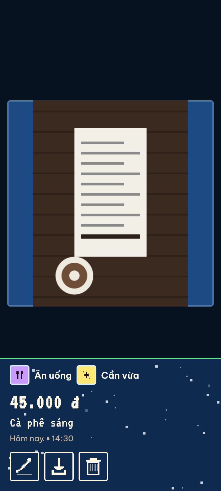
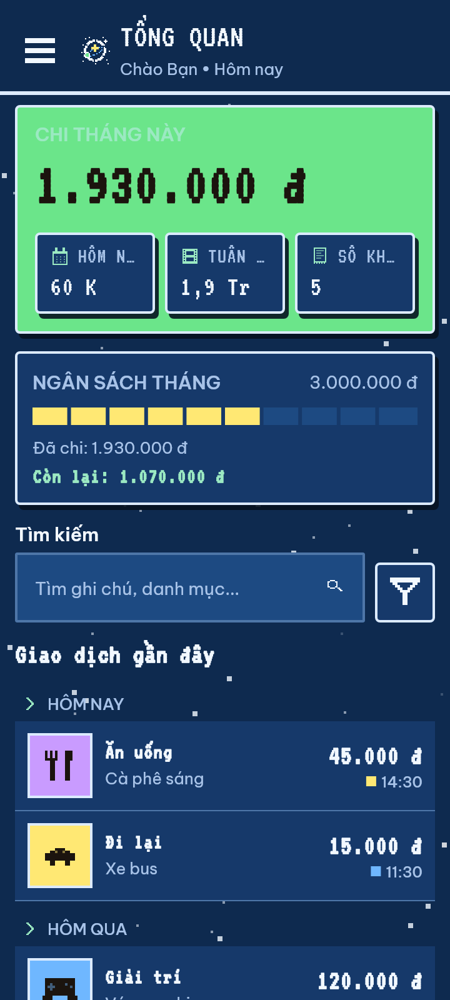
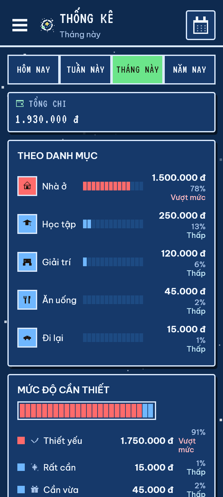
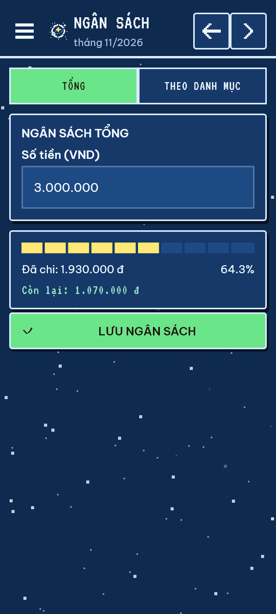
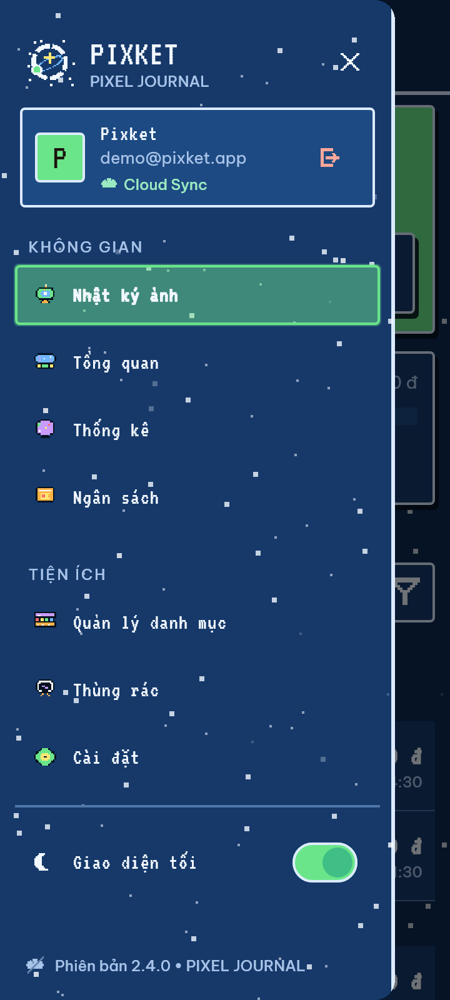
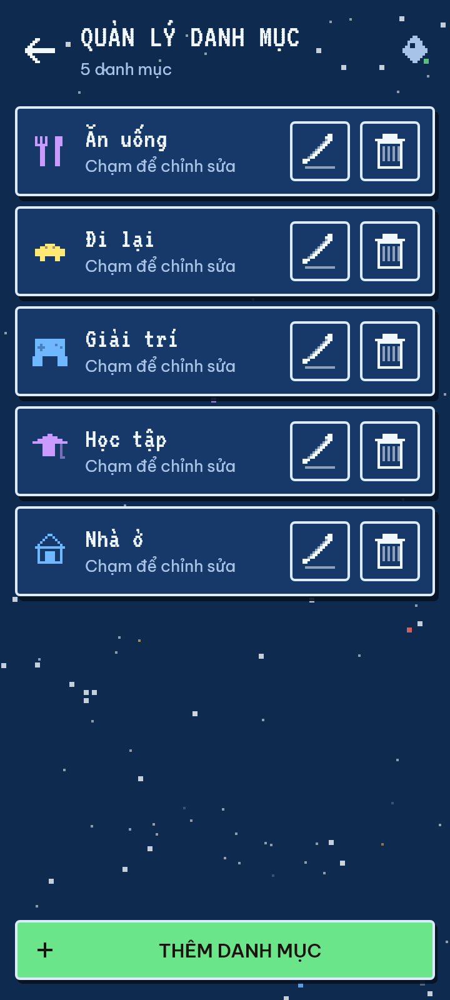

<p align="center">
  
</p>

<h1 align="center">Pixket — Pixel Expense Journal</h1>

<p align="center">
  <b>Nhật ký chi tiêu bằng ảnh kiểu Locket, giao diện Pixel tự vẽ, lưu trực tiếp trên Supabase (Auth, PostgreSQL RLS, Storage private) và bắt buộc đăng nhập.</b>
</p>

<p align="center">
  
  
  
  
  
  
  
</p>

---

## 🌟 Giới thiệu

**Pixket** là ứng dụng quản lý tài chính cá nhân với trải nghiệm **nhật ký ảnh**:
mở app là camera, chụp hóa đơn hoặc khoảnh khắc chi tiêu, rồi lướt dọc để xem lại
từng khoản chi như một dòng thời gian. Toàn màn hình, không có thanh tab đáy:
điều hướng bằng nút **3 gạch** ở góc trên trái hoặc **vuốt ngang**.

Giao diện theo ngôn ngữ **Pixel**: bảng ký tự 16×16, icon tự vẽ bằng `CustomPainter`
lấy cảm hứng bảng điều khiển tàu vũ trụ, panel viền vuông và font VT323 — không dùng
icon hệ thống, không gradient, không dải 7 màu chạy.

Toàn bộ khoản chi, danh mục, ngân sách và ảnh được lưu **trực tiếp trên Supabase**;
không có bản sao dữ liệu tài chính trên thiết bị và không cần thao tác đồng bộ thủ công.

---

## 📸 Demo

<table>
  <tr>
    <td align="center" width="33%">
      <br/>
      <b>Nhật ký ảnh</b><br/>Ảnh khoản chi toàn màn hình + HUD pixel
    </td>
    <td align="center" width="33%">
      <br/>
      <b>Tổng quan</b><br/>Chi tháng, ngân sách, giao dịch gần đây
    </td>
    <td align="center" width="33%">
      <br/>
      <b>Thống kê</b><br/>Biểu đồ pixel theo danh mục và ngày
    </td>
  </tr>
  <tr>
    <td align="center">
      <br/>
      <b>Ngân sách</b><br/>Thanh ramp mức chi của tháng
    </td>
    <td align="center">
      <br/>
      <b>Drawer</b><br/>Điều hướng, hồ sơ cloud, đổi giao diện
    </td>
    <td align="center">
      <br/>
      <b>Danh mục</b><br/>Bộ glyph 16×16 tự vẽ theo danh mục
    </td>
  </tr>
</table>

Ảnh render bằng `flutter test` trên đúng widget pixel hiện tại (khung nhìn 360×800 dp),
không phải ảnh chụp từ thiết bị, và toàn bộ số liệu là dữ liệu demo đặt sẵn trong
`test/tool/demo_screenshots_test.dart`. Muốn dựng lại ảnh:
`PIXKET_GEN_SHOTS=1 flutter test test/tool/demo_screenshots_test.dart`.

---

## 🚀 Tính năng nổi bật

### 1. 📸 Nhật ký ảnh kiểu Locket
- Trang đầu tiên là **camera trực tiếp** với nút chụp, thư viện và đổi camera.
- Vuốt dọc để xem lần lượt các khoản chi có ảnh, **mới nhất trước**.
- Ảnh toàn màn hình kèm danh mục, mức độ cần thiết, số tiền, ghi chú, ngày giờ.
- Nút sửa/xóa là nút pixel viền vuông; xóa chuyển vào thùng rác kèm hoàn tác trong 5 giây.
- Ảnh cloud tải qua **signed URL hạn 24 giờ** và hiển thị bằng glyph `receipt` khi chưa tải được.
- Nút góc phải mở **xem ảnh dạng lưới**, chạm một ảnh để nhảy tới đúng khoảnh khắc trong feed.

### 2. ☰ Điều hướng bằng Drawer
- Không còn thanh tab đáy: 4 khu vực chuyển qua drawer, màn hình luôn toàn khung.
- Nút 3 gạch pixel cố định ở góc trên trái của mọi màn hình chính.
- **Vuốt ngang** cũng mở drawer: SỔ/BIỂU/NGÂN nhận vuốt ở bất kỳ đâu, CHỤP chỉ nhận
  vuốt từ mép trái ~24 px để không giành cử chỉ với feed dọc.
- Drawer gồm: hồ sơ người dùng, **Nhật ký ảnh**, **Tổng quan**, **Thống kê**, **Ngân sách**,
  quản lý danh mục, thùng rác, cài đặt và chuyển sáng/tối. Mục đang chọn có nền mint
  mờ, viền mint và glow nhẹ; nền drawer là bầu trời sao ở chế độ tối.
- Hiển thị trạng thái cloud (đang kết nối / chưa cấu hình) ngay trong drawer.

### 3. 🎮 Giao diện Pixel
- **63 glyph 16×16** tự vẽ trong `lib/core/icons/pixel_glyph_data.dart`, render bằng
  `CustomPainter` qua `AppIcon`; không còn ký hiệu `Icons.*` nào trong `lib/`. Bộ glyph
  khu vực vẽ theo bảng điều khiển tàu vũ trụ (`holocam`, `bridge`, `radar`, `cargo`) và
  tiện ích (`console`, `airlock`, `engine`), mỗi glyph dùng ≥ 3 màu.
- Logo **"Lens Orbit"** do `buildLogoGrid(n)` dựng thủ tục trên lưới 24×24 nhân tỉ lệ:
  vành ống kính khía sáu rãnh, quỹ đạo nghiêng, vì sao vàng giữa ống kính, một hành tinh
  trên mép vành và sao nền chỉ vẽ ở theme tối. Icon launcher Android sinh từ chính lưới này.
- Panel viền vuông 2–3 px, bóng cứng lệch `(3, 4)`, không gradient ở `lib/screens/`.
- Bảng màu `AppPalette` (ThemeExtension): nền kem `#FFF6E3` + nhấn mint `#7BD8A8`,
  có phiên bản tối cho nhật ký ảnh.
- Font **VT323** (tiêu đề, số tiền) + **Be Vietnam Pro** (nội dung), bundle offline trong
  `assets/fonts/` kèm OFL — không dùng `google_fonts`, không tải font lúc chạy.
- Nút/chip đổi trạng thái trong 120 ms; đổi khu vực **fade + scale 0.98→1 trong 180 ms**
  (có thể hủy giữa chừng, không lật mosaic).
- Mọi mục chạm đều ≥ 48 dp; hỗ trợ text scale 1.3× (đã test ở 360×520).
- Hiệu ứng thương hiệu luôn bật, tôn trọng `MediaQuery.disableAnimations` (giảm bậc,
  vẫn hoàn tất và vẫn gọi callback đúng một lần):

  | Hiệu ứng | Widget | Nội dung |
  |---|---|---|
  | Bầu trời sao | `pixel_star_field.dart` | Chỉ ở chế độ tối: sao nhấp nháy 1400 ms, trôi 30 s, sao băng mỗi ~20–30 s; có ở màn chính, drawer, sheet tối, login/onboarding, lưới ảnh và trang xem ảnh |
  | Chụp ảnh | `pixel_iris.dart` | Ống kính pixel khép–mở ~260 ms, `RepaintBoundary`, `onCovered` lúc che kín để mở form |
  | Lưu khoản chi | `pixel_star_flash.dart` | 5 sao pixel lóe rồi tan ~350 ms tại vị trí nút lưu + toast |
  | Đổi khu vực | `main_screen.dart` | `AnimatedSwitcher` fade + scale 180 ms |
  | `chart_spend_ramp` | `pixel_progress` / biểu đồ | Toggle duy nhất còn lại trong **Cài đặt → GIAO DIỆN & BIỂU ĐỒ**: tô theo bậc mức chi thay vì theo danh mục |

### 4. 🔐 Xác thực Supabase
- Đăng nhập/đăng ký **Email & Mật khẩu**.
- **Google OAuth** qua trình duyệt, quay lại app bằng deep link
  `io.supabase.pixket://login-callback/`.
- **Quên mật khẩu**: gửi link PKCE, mở link để về màn đặt lại mật khẩu trong app.
- Bắt buộc đăng nhập; không có chế độ khách hay ngoại tuyến.
- Kiểm tra provider Google trước khi mở trình duyệt để báo lỗi rõ ràng thay vì trang JSON.

### 5. ☁️ Cloud-first & Bảo mật RLS
- PostgreSQL + Row Level Security: mỗi người dùng chỉ thấy dữ liệu của mình.
- Hồ sơ `profiles` tạo tự động bằng trigger khi đăng ký.
- Ảnh hóa đơn upload lên bucket **private** `expense-receipts`, cột `image_url` lưu
  storage path chứ không lưu URL công khai.
- Rollback: ghi DB thất bại thì ảnh vừa upload bị xóa, không để lại tệp mồ côi.
- Không lưu dữ liệu tài chính hay ảnh hóa đơn trên máy; ảnh tạm được dọn sau khi lưu.
- Khi mất mạng hoặc upload thất bại, app báo lỗi và không lưu khoản chi.

### 6. 📊 Thống kê & Ngân sách
- Biểu đồ pixel tự vẽ: thanh phân bổ theo danh mục, chồng tích lũy, cột theo mức độ cần thiết.
- Thống kê hôm nay/tuần/tháng/năm hoặc khoảng ngày tùy chọn.
- Ngân sách tổng hoặc theo danh mục, thanh tiến trình đổi màu theo hạn mức.
- Vượt hạn mức hiển thị **"Quá ngân sách: X"**, không hiển thị số còn lại âm.
- Cảnh báo một lần ở các mốc 80%, 90%, 100% ngân sách tháng.
- Thùng rác cho phép khôi phục hoặc xóa hẳn khoản chi đã xóa.

### 7. 🧮 Nhập liệu an toàn
- Ô số tiền tự chèn dấu chấm nhóm nghìn, chặn ký tự lạ, tối đa 12 chữ số.
- Mọi chỗ đọc số tiền dùng `CurrencyFormatter.parseInput` — không `int.parse` trực tiếp.
- Khoản chi chọn được ngày giờ, chặn tương lai và chặn xa quá 10 năm, có nút "Bây giờ".

---

## 🛠️ Công nghệ sử dụng

| Tầng | Công nghệ / Thư viện | Mục đích |
| :--- | :--- | :--- |
| **Framework** | Flutter 3.47+ (Dart 3.13+) | Ứng dụng Android |
| **State Management** | `flutter_riverpod` ^2.6.1 | StateNotifier, quản lý trạng thái |
| **Cloud Database** | `supabase_flutter` ^2.8.3 | Auth, PostgreSQL RLS, Storage private + signed URL |
| **Cài đặt cục bộ** | `sqflite` ^2.4.2 | Chỉ lưu onboarding và mức độ cần thiết |
| **Giao diện** | `AppPalette` (ThemeExtension), font bundle VT323 + Be Vietnam Pro | Pixel sáng/tối, không dùng `google_fonts` |
| **Icon** | `pixel_glyph_data.dart` + `CustomPainter` | 63 glyph 16×16 tự vẽ, không dùng `Icons.*` |
| **Biểu đồ** | Widget pixel tự vẽ (`PixelShareBar`, `PixelStackedShare`, `PixelBarChart`) | Không dùng `fl_chart` |
| **Camera & Ảnh** | `camera`, `image_picker`, `cached_network_image` | Chụp, chọn, cache ảnh cloud |
| **Xử lý ảnh** | `image` ^4.12.0, `gal` ^2.3.3 | Cắt ô vuông 1:1 + nén JPEG 1200px, lưu ảnh vào thư viện máy |
| **Môi trường** | `flutter_dotenv` ^5.2.1 | Đọc `.env` |
| **Kiểm thử** | `flutter_test` | 371 Unit & Widget tests |

---

## 📁 Cấu trúc Thư mục

```text
pixket/
├── .github/workflows/         # supabase-keepalive.yml + build-apk.yml
├── android/                   # Manifest, quyền, OAuth deep link, icon pixel
├── assets/fonts/              # VT323 + Be Vietnam Pro bundle offline (OFL)
├── docs/                      # Cấu trúc, yêu cầu, OAuth, keep-alive, brand
├── lib/
│   ├── core/
│   │   ├── icons/             # pixel_glyph_data.dart (63 glyph 16×16)
│   │   ├── theme/             # app_palette, app_theme, pixel_text_theme
│   │   ├── constants/         # AppInfo (Pixket, 2.5.0+6), AppStrings
│   │   ├── config/            # supabase_config.dart
│   │   └── utils/             # formatter, square_image, save_to_gallery, icon_helper, storage_paths
│   ├── data/
│   │   ├── models/            # Expense, Category, Budget, PriorityLevel
│   │   └── repositories/      # auth, expense, category, budget, supabase_storage_service
│   ├── providers/             # Riverpod StateNotifier
│   ├── screens/
│   │   ├── main_screen.dart   # Drawer + starfield + vuốt ngang, không tab bar đáy
│   │   ├── auth/              # Login, Register, quên/đặt lại mật khẩu
│   │   ├── camera/            # Locket feed, camera, form, lưới ảnh
│   │   ├── home/              # Tổng quan + lọc khoản chi
│   │   ├── statistics/        # Thống kê + biểu đồ pixel
│   │   ├── budget/            # Ngân sách
│   │   ├── categories/        # Danh mục + bảng glyph
│   │   ├── settings/          # Cài đặt
│   │   ├── trash/             # Thùng rác
│   │   └── onboarding/        # Giới thiệu lần đầu
│   └── widgets/
│       ├── app_drawer.dart    # Drawer 3 gạch: chọn khu vực + tiện ích
│       └── pixel/             # 27 widget pixel (button, chip, panel, chart, star field, iris, star flash, ...)
├── test/                      # 371 Unit & Widget tests
├── supabase_setup.sql         # Bảng + RLS + Storage
├── .env.example               # Mẫu biến môi trường
└── pubspec.yaml
```

Chi tiết xem tại [docs/project-structure.md](docs/project-structure.md).

---

## ⚡ Hướng dẫn Cài đặt & Khởi chạy

### 1. Yêu cầu môi trường
- Flutter SDK 3.47+.
- Android Studio / VS Code + Android SDK + JDK 17 (để build APK tại máy).
- Tài khoản Supabase.

### 2. Tải mã nguồn
```bash
git clone https://github.com/beloncuaem/pixket.git
cd pixket
flutter pub get
```

### 3. Cấu hình Supabase
1. Tạo project tại [supabase.com](https://supabase.com).
2. Mở **SQL Editor**, chạy toàn bộ [supabase_setup.sql](supabase_setup.sql).
3. Tạo `.env` từ mẫu (**file này là asset bắt buộc trong `pubspec.yaml`, thiếu là không build được**):
   ```bash
   cp .env.example .env
   ```
   Điền thông tin từ **Project Settings → API**:
   ```env
   SUPABASE_URL=https://your-project-id.supabase.co
   SUPABASE_ANON_KEY=your-supabase-anon-key
   ```
4. Trong **Authentication → Providers**, bật **Email**.
5. Muốn dùng Google: bật **Google** và cấu hình OAuth Client ID/Secret.
   Làm theo [docs/google-oauth-troubleshooting.md](docs/google-oauth-troubleshooting.md).
6. Trong **Authentication → URL Configuration**, thêm redirect:
   ```text
   io.supabase.pixket://login-callback/
   ```

> Không commit `.env` (đã nằm trong `.gitignore`). Chỉ anon/publishable key được nhúng
> vào app; tuyệt đối không dùng `service_role` key trong client hay trong workflow.

Bucket `expense-receipts` là **private**: app lưu đúng storage path `<user_id>/<file>`
vào cột `image_url` và hiển thị ảnh qua **signed URL hạn 24 giờ**. Ảnh cũ dạng public URL
vẫn đọc được vì client tự quy về path, nhưng app không ghi mới URL public.

### 3b. Giữ Supabase hoạt động

Supabase free tier tạm dừng project sau 7 ngày không có hoạt động. Bật workflow
keep-alive và theo dõi hướng dẫn tại [docs/supabase-keepalive.md](docs/supabase-keepalive.md).

### 4. Chạy ứng dụng
```bash
flutter run
```

### 5. Xuất APK

Cách 1 — GitHub Actions (khuyến nghị, không cần máy có Android SDK):
mở tab **Actions** → workflow **Build APK** → **Run workflow**. Workflow chạy
`flutter analyze` + `flutter test` trước, rồi build và đính kèm artifact
`pixket-release-apk` chứa `app-release.apk`. Cần thêm hai repository secret
`SUPABASE_URL` và `SUPABASE_ANON_KEY` (anon key, không phải `service_role`).

Cách 2 — build tại máy (cần Android SDK + JDK 17):
```bash
flutter build apk --release
```
File: `build/app/outputs/flutter-apk/app-release.apk`

> Máy phát triển của dự án này chưa cài Android SDK/JDK nên `flutter build apk`
> không chạy được tại chỗ; hãy dùng Cách 1.

---

## 💾 Ảnh, sao lưu & khôi phục dữ liệu

- **Chuẩn hoá ảnh vuông 1:1**: camera cắt ô vuông giữa của ảnh rồi nén JPEG cạnh 1200px
  (`lib/core/utils/square_image.dart`), khoảng 250–350 KB mỗi ảnh thay vì 1,5–3 MB ảnh
  full-screen. Ảnh đã cắt mang marker `_sq.jpg` ngay trong path object, nên không cần thêm
  cột nào để phân biệt với ảnh cũ.
- **Ảnh cũ (legacy)**: mở dashboard là app tự tải tối đa 5 ảnh chưa marker, cắt vuông, upload
  object mới, `update` cột `image_url` rồi mới xóa object cũ. Ảnh legacy hiển thị bằng
  `BoxFit.contain` nên không bị cắt mất hai bên trước khi kịp migration.
- **Tải ảnh về máy**: trang ảnh → nút "Tải ảnh về máy", lưu vào thư viện ảnh của thiết bị qua
  `gal`. Khoản chi chưa upload thì lấy tệp cục bộ; không có ảnh thì app báo rõ thay vì im lặng.
- **Khôi phục ảnh**: muốn mang ảnh sang project Supabase khác phải tải riêng từng object
  qua Storage API.
- **Quên mật khẩu**: Màn hình đăng nhập → "Quên mật khẩu?" → nhập email. Supabase gửi link đặt lại;
  mở link trên chính thiết bị đã cài app để deep link `io.supabase.pixket://login-callback/`
  đưa app về màn đặt mật khẩu mới.

---

## 🧪 Kiểm thử

```bash
flutter analyze     # No issues found!
flutter test        # 371 passed, 7 skip (test sinh icon + 6 test sinh ảnh demo,
                    # cần PIXKET_GEN_ICONS=1 / PIXKET_GEN_SHOTS=1)
```

- **Unit Tests**: model, formatter VND/ngày, `ThousandsSeparatorInputFormatter`,
  `CurrencyFormatter.parseInput`, giới hạn ngày giờ, `cropToSquareBytes` + marker `_sq` +
  migration lazy, `saveReceiptToGallery`, `StoragePaths`,
  `pixel_allocate`, trạng thái ngân sách/thống kê/auth, ánh xạ icon + hợp lệ 63 glyph,
  sắp xếp feed ảnh, `PixelReceiptImage`.
- **Widget Tests**: Login/Register/Quên mật khẩu/Đặt lại mật khẩu, onboarding, dashboard,
  form khoản chi, camera + ảnh toàn màn hình + lưới ảnh, thống kê, ngân sách, danh mục,
  thùng rác, cài đặt, AppDrawer, điều hướng chính (drawer + vuốt ngang, không tab bar),
  hiệu ứng `PixelIris`/`PixelStarFlash`/`PixelStarField`, và bộ widget pixel (nút, chip,
  panel, empty state, segmented, badge, ô nhập, hộp thoại xác nhận).
- **Test chốt đường lùi**: `test/widget/legacy_cleanup_test.dart` bảo đảm `lib/` không còn
  `AppColors`, `Icons.`, `GlassCard`, `fl_chart`, `google_fonts`, gradient, 8 file widget
  cũ, tab bar đáy và 5 widget dải 7 màu — kế hoạch sau này lỡ thêm lại sẽ bị test đỏ.

### Đã xác minh trên emulator Android API 35 (trước đợt redesign Pixel)
- Onboarding và cấp quyền camera/thông báo.
- Đăng nhập email sai → Supabase trả `Invalid login credentials`
  → app hiển thị **"Email hoặc mật khẩu không chính xác."** (xác nhận kết nối backend).
- Feed dọc, nút 3 gạch, drawer và 4 khu vực hiển thị đúng.
- Google OAuth được chặn rõ ràng khi provider chưa bật (xem tài liệu troubleshooting).
- **Bản release APK** cài trên emulator: trang ảnh Locket mở đúng, drawer chuyển trang hoạt động,
  icon status bar đổi theo nền sáng/tối.

### Chưa xác minh trên thiết bị
Những mục dưới đây **chỉ được chứng minh bằng widget test và `flutter analyze`**, chưa chạy
th thủ công trên máy thật sau đợt redesign Pixel:
1. Feed Locket + trang camera: bố cục pixel thật trên màn hình, camera preview có bị che
   bởi HUD hay không.
2. Keyboard khi nhập số tiền/chọn ngày giờ trong bottom sheet (inset, cuộn, che nút).
3. Tải ảnh thật từ bucket private qua signed URL trên thiết bị, và ảnh legacy còn hiển thị.
4. Cắt vuông khi chụp bằng camera thật và `gal` lưu ảnh vào thư viện Android (từ API 29 dùng
   scoped storage, `WRITE_EXTERNAL_STORAGE` chỉ áp cho API ≤ 28).
5. Email đặt lại mật khẩu + deep link mở lại app, và `updateUser(password:)` có đòi
   reauthentication hay không (tùy cấu hình project Supabase).

---

## 🔧 Khắc phục sự cố Google OAuth

Lỗi phổ biến khi cài APK:

```json
{"code":400,"error_code":"validation_failed","msg":"Unsupported provider: provider is not enabled"}
```

Nguyên nhân: **Google provider chưa được bật trong Supabase Dashboard**, không phải lỗi APK.
Chi tiết bằng chứng và các bước sửa:
[docs/google-oauth-troubleshooting.md](docs/google-oauth-troubleshooting.md).

---

## ✅ Việc người dùng cần tự làm

1. Chạy lại `supabase_setup.sql` (bucket private + unique index `budgets`).
2. Thêm repository secret `SUPABASE_URL`, `SUPABASE_ANON_KEY` cho workflow keep-alive và build APK.
3. Chạy workflow **Supabase keep-alive** một lần và xác nhận `HTTP 200`; đặt cron-job.org làm dự phòng.
4. Bật Google provider trong Supabase nếu muốn đăng nhập Google.
5. Giữ project Supabase có hoạt động hằng ngày để không bị pause lại sau 7 ngày.

---

## 📄 Giấy phép

Dự án phát hành theo **MIT License**.
